# Gallery

All pictures are painted from the code by `python3 tools/update_previews.py` (see the [README](README.md#screenshots)).

## On-screen dial

The dial in its main states: the radial menu, a level gauge, an endless function and a profile bound to one function.

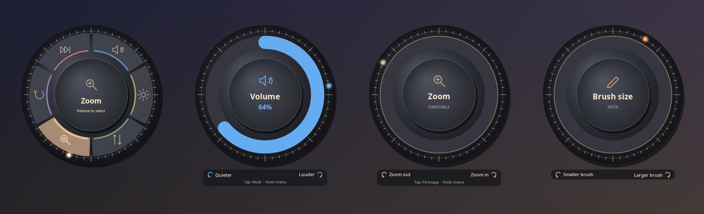

**Built-in skins.** Five looks to start from; make your own in the skin editor or write it as JSON by hand or with an AI assistant ([SKINS.md](SKINS.md)).

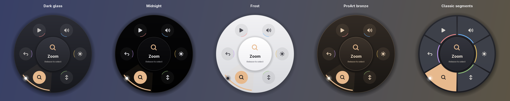

**Shapes.** A skin also sets the outline of the dial and the shape of its tiles, or uses an outline you draw in the editor.

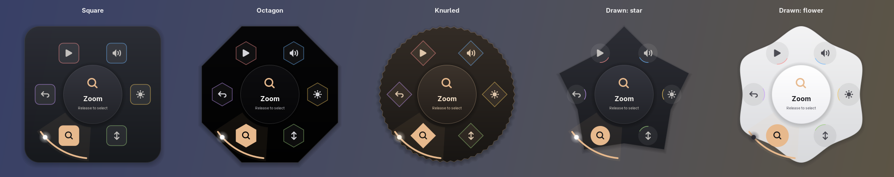

**Background pictures.** The example skin in [`examples/skins/`](examples/skins/): *Gertie the Dinosaur* by Winsor McCay (1914, public domain, from [Wikimedia Commons](https://commons.wikimedia.org/wiki/File:Gertie_the_Dinosaur_with_her_mouth_open.jpg)) behind a see-through centre and a spiky drawn outline.

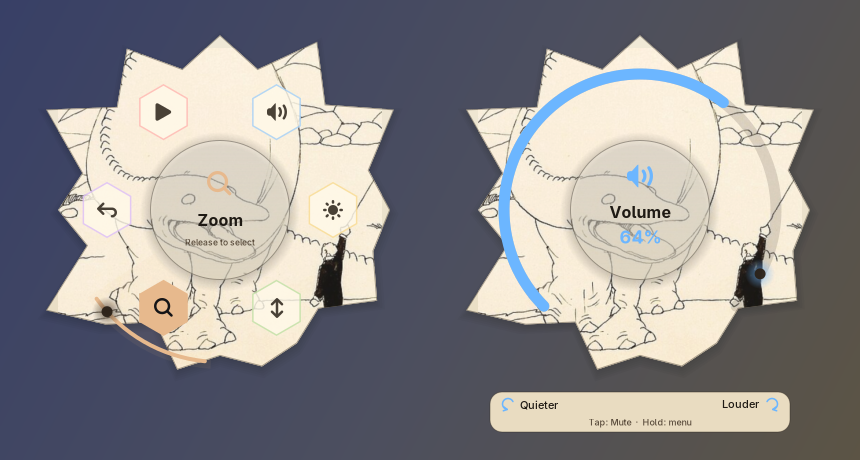

## Settings app

| | |
|---|---|
| 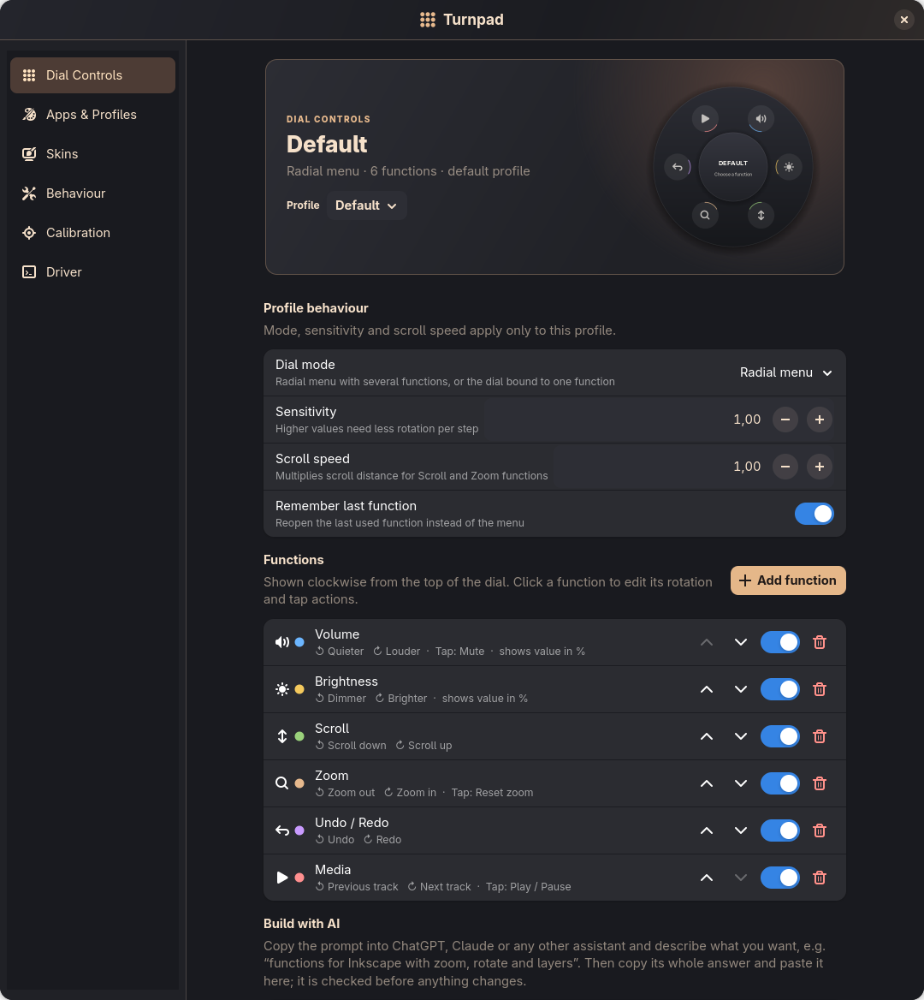 | 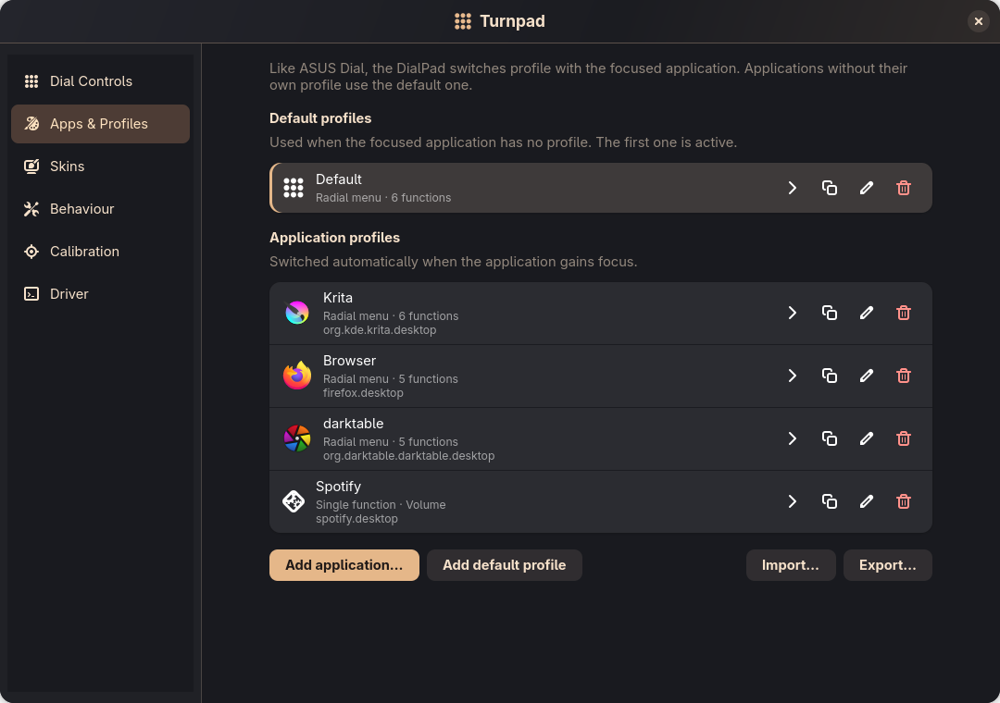 |
| Functions of a profile, in dial order | Default and application profiles |
| 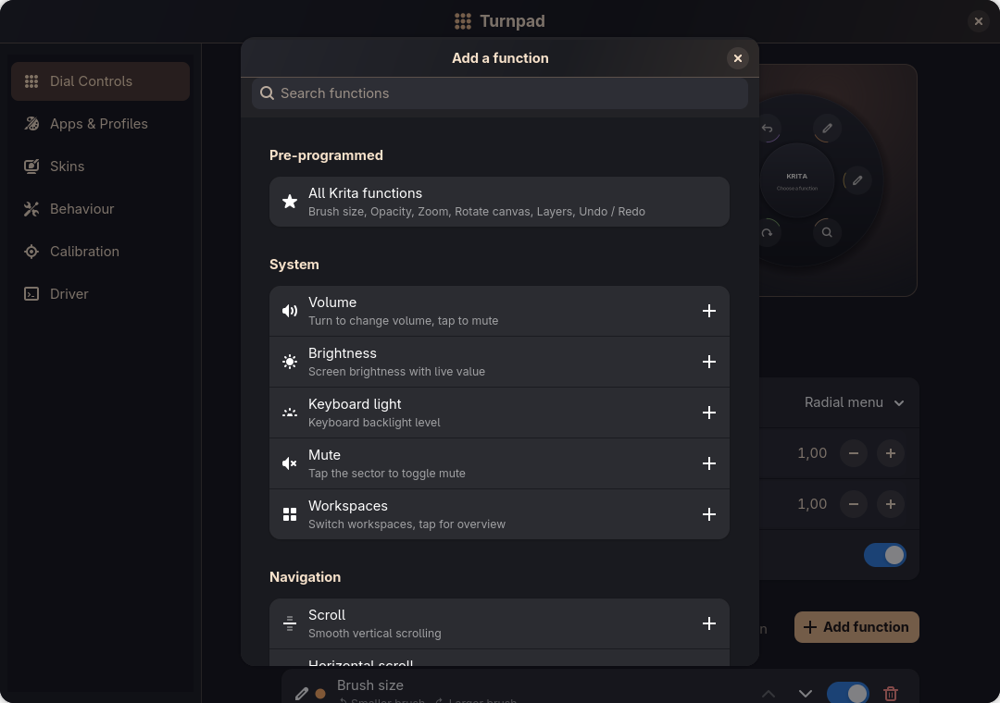 | 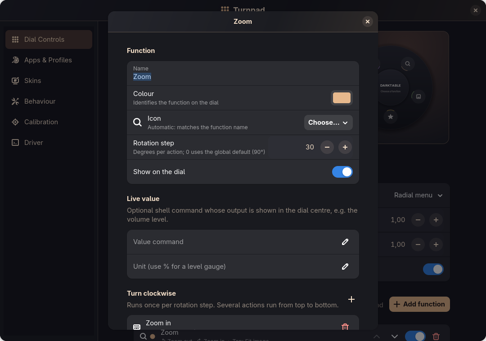 |
| Ready functions and app packs | Colour, icon, live value and actions of a function |
| 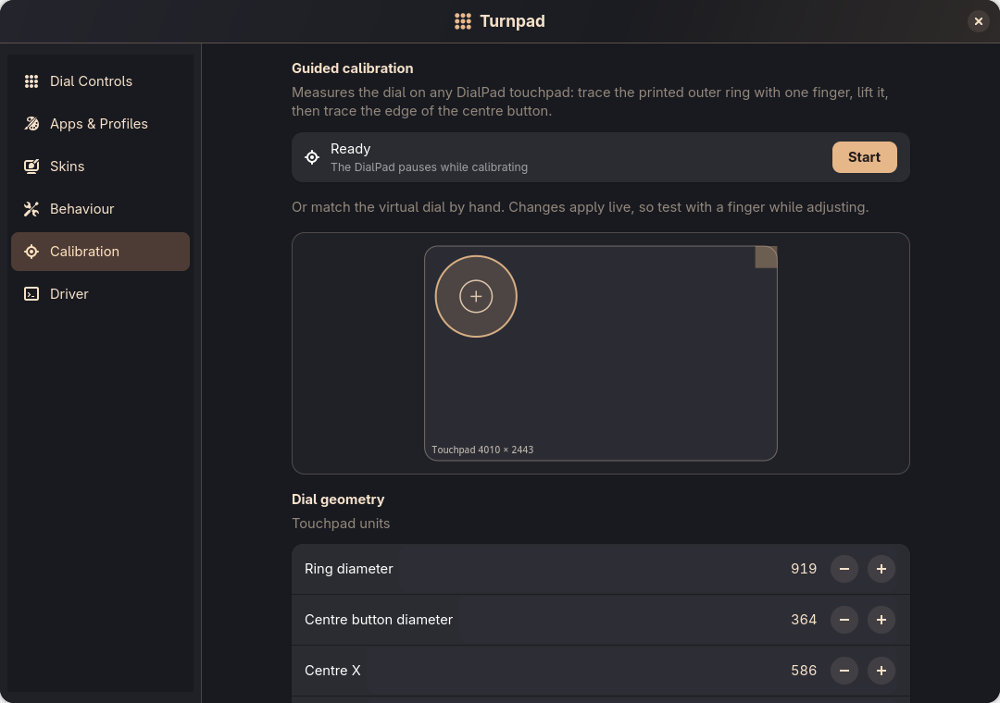 | 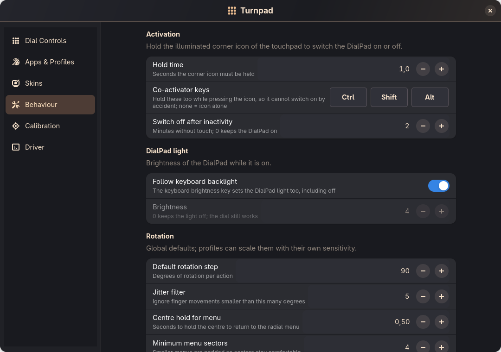 |
| Guided and manual calibration | Activation, DialPad light and rotation |
| 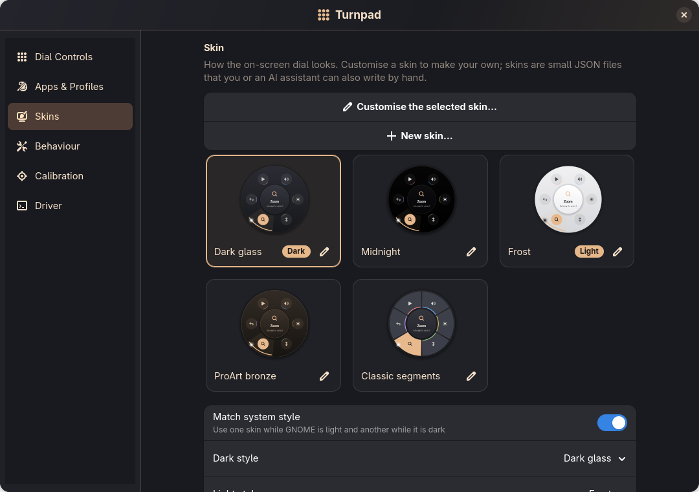 | 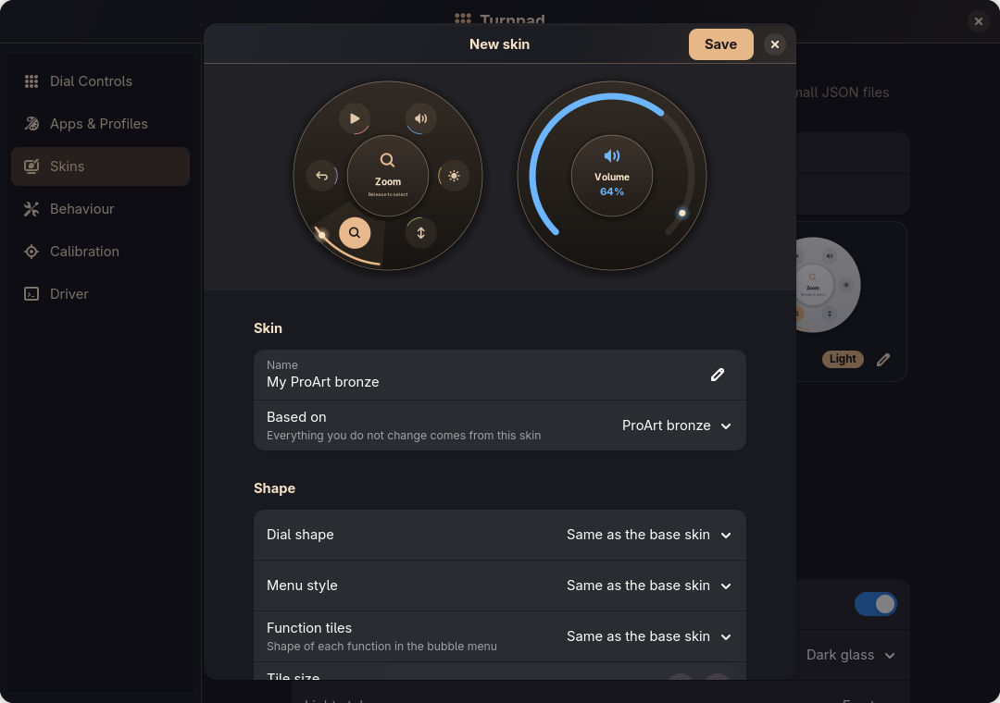 |
| Skins page: gallery, light and dark choice, on-screen dial | Skin editor with a live preview |
| 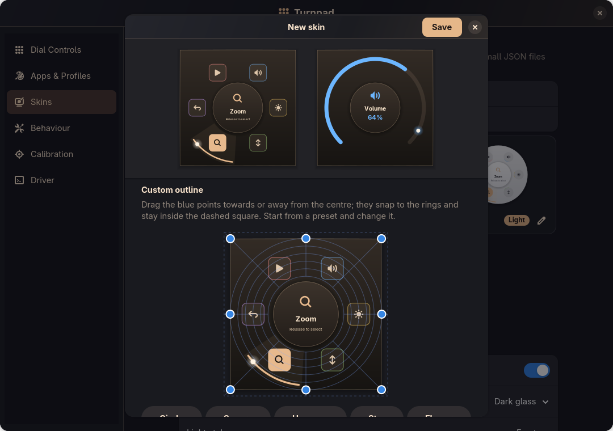 | |
| Drawing your own outline | |
